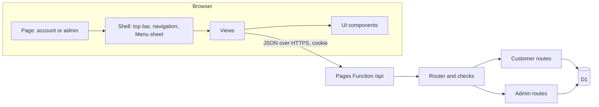
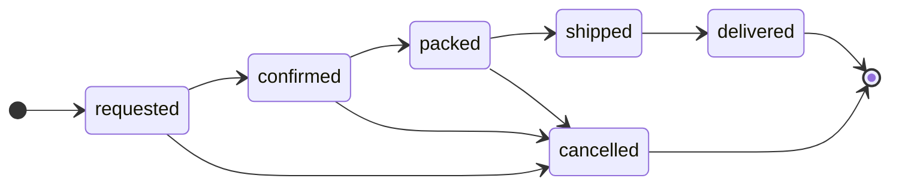

# Customer and admin dashboards

How the two dashboards are built, how they stay safe, and how to work on them. To put them live on Cloudflare, follow [deployment.md](deployment.md). For the look and the building blocks, see [design-system.md](design-system.md) and [components.md](components.md).

## What is in the repository

| Path | What it is |
| --- | --- |
| `account/` | The customer dashboard page (`index.html`), its entry script and its views (`views/auth.js`, `orders.js`, `request.js`, `profile.js`, `password.js`) |
| `admin/` | The store admin page, its entry script and its views (`login.js`, `overview.js`, `orders.js`, `customers.js`, `products.js`, `activity.js`) |
| `dashboard/core/` | Small helpers: DOM builder, API client, formatting, hash router |
| `dashboard/ui/` | The component library every view is built from |
| `dashboard/shell/shell.js` | The frame around every page: top bar, side navigation (desktop), Menu sheet (phone and tablet), footer |
| `dashboard/css/` | Design tokens, base styles, layout, components, motion |
| `functions/api/[[path]].js` | The Cloudflare Pages Function that answers every `/api/*` request |
| `functions/_shared/` | The store service: router, customer and admin routes, sign-in and sessions, password hashing, validation |
| `migrations/0001_init.sql` | The D1 database plan (tables, and the six starter products) |
| `_headers` | Security headers Cloudflare Pages sends with the dashboards |
| `scripts/` | `dev-server.mjs` (local demo), `admin-setup.mjs` (admin values), `screenshots.mjs` (README pictures) |
| `tests/` | Service tests, setup-script tests, and a browser test (`tests/e2e/`) |

There is **no framework and no build step**. Pages are plain ES modules that the browser loads directly, so what is in the repository is exactly what is published.

## How the pieces fit



## Screens and their addresses

Both pages use the address hash for the current section, so a reload or a shared link comes back to the same place.

| Page | Section | Address ends with |
| --- | --- | --- |
| Customer `/account/` | My orders | `#orders` |
| | Request an order | `#request` |
| | My details | `#profile` |
| | Password | `#password` |
| Admin `/admin/` | Overview | `#overview` |
| | Orders (and one open order) | `#orders`, `#orders/<id>` |
| | Customers | `#customers` |
| | Products | `#products` |
| | Activity | `#activity` |

A customer who has been given a temporary password is taken to *Password* until they choose their own.

## Order flow



- The rules live in `ORDER_FLOW` in `functions/_shared/store.js` and are enforced on the server, so a changed page cannot skip a step.
- A customer can cancel only their own request, and only while it is `requested`.
- When an order is placed, the items and prices are copied into the order. Later price changes never alter an existing order.
- A customer can have at most 10 open requests at once.

## Security model

| Concern | What is done |
| --- | --- |
| Customer passwords | At least 10 characters. Stored only as a PBKDF2-SHA-256 hash with a random salt (100,000 rounds, the most Cloudflare Workers allows) |
| Admin sign-in | Email, password **and** a time-based one-time code. Each code is accepted once, and the code for the current 30-second step plus one either side is allowed for clock drift. The email, password hash, salt and authenticator key are Cloudflare secrets, never in the repository or the database |
| Sessions | A random token in a `__Host-` cookie (`HttpOnly`, `Secure`, `SameSite=Strict`). Only a SHA-256 hash of the token is stored. Customers last 7 days, the admin 8 hours. Changing a password ends the person's other sessions |
| Wrong guesses | Failure counters per account and per network address. For customers: 5 wrong tries on one account, or 30 from one address, pause sign-in for 15 minutes. For the admin: 5 wrong tries in total, or 10 from one address, pause admin sign-in for 15 minutes. The message does not say which part was wrong, and failed admin sign-ins are written to the activity log |
| Cross-site requests | Every change (`POST`, `PATCH`) must come from the same site: `Origin` must match and `Sec-Fetch-Site` must be `same-origin` or `none` |
| Page scripts | The `_headers` file sets a strict Content-Security-Policy: scripts and styles only from the site itself, no inline scripts and no inline styles, no framing, no form posts elsewhere. The code is written to fit it (see below) |
| Caching | `/account/*` and `/admin/*` are sent with `Cache-Control: no-store` so a shared computer does not keep pages |
| Data separation | Every customer query is filtered by the signed-in customer's id. Admin routes check the admin session on every request |
| Audit | Every admin sign-in and change is written to `audit_log` and shown in the Activity tab |
| Health endpoint | `/api/health` returns only three yes/no values and never any secret |

**Writing code that fits the Content-Security-Policy.** There are no inline `style` attributes anywhere. The `h()` helper in `dashboard/core/dom.js` throws if you try to pass one. For one-off values (animation delay, bar widths) use `el.style.setProperty('--name', value)` and read the variable in the stylesheet.

## The service (API)

All answers are JSON. Errors look like `{ "error": "Plain words the person can read." }`. Responses are `401` when a session is missing or has ended and `403` when a request is refused (for example a wrong current password).

### Public

| Method and path | Purpose |
| --- | --- |
| `GET /api/health` | Is the database connected and is admin sign-in set up |
| `GET /api/products` | The products customers can choose |

### Customer (needs the customer cookie, except register and login)

| Method and path | Purpose |
| --- | --- |
| `POST /api/customer/register` | Create an account and sign in |
| `POST /api/customer/login` | Sign in |
| `POST /api/customer/logout` | Sign out |
| `GET /api/customer/me` | Who am I |
| `PATCH /api/customer/me` | Change name, phone or delivery address |
| `POST /api/customer/password` | Change password (needs the current one) |
| `GET /api/customer/orders` | My order requests |
| `POST /api/customer/orders` | Send an order request |
| `GET /api/customer/orders/:id` | One of my orders |
| `POST /api/customer/orders/:id/cancel` | Cancel one of my requests that is still waiting |

### Admin (needs the admin cookie, except login)

| Method and path | Purpose |
| --- | --- |
| `POST /api/admin/login` | Email, password and code |
| `POST /api/admin/logout` | Sign out |
| `GET /api/admin/me` | Who am I |
| `GET /api/admin/summary` | Numbers, pipeline and latest requests for the Overview |
| `GET /api/admin/orders` | Orders, optionally filtered by status |
| `GET /api/admin/orders/:id` | One order |
| `PATCH /api/admin/orders/:id` | Move to the next status and/or save the internal note |
| `GET /api/admin/customers` | Customers |
| `GET /api/admin/customers/:id` | One customer and their orders |
| `PATCH /api/admin/customers/:id` | Disable or enable the account |
| `POST /api/admin/customers/:id/reset-password` | Create a one-time temporary password |
| `GET /api/admin/products` | All products, including hidden ones |
| `POST /api/admin/products` | Add a product |
| `PATCH /api/admin/products/:id` | Edit a product |
| `GET /api/admin/audit` | The latest 100 sign-ins and changes |

## Working on it

### Run the demo

```bash
node --no-warnings scripts/dev-server.mjs            # demo data
node --no-warnings scripts/dev-server.mjs --empty    # no orders, create an account to try it
node --no-warnings scripts/dev-server.mjs --port 9000
```

Needs Node 22.5 or newer (it uses the built-in SQLite to stand in for D1, so there is nothing to install). Everything is in memory and listens on this computer only. The demo passwords must never be reused anywhere.

### Testing

```bash
python3 -m unittest discover -s tests -v          # storefront structure checks
python3 scripts/verify_app.py                     # storefront syntax check
node --no-warnings --test "tests/*.test.mjs"      # service and setup-script tests (Node 22.5+)
node --no-warnings tests/e2e/dashboards.e2e.mjs   # browser test (needs Playwright)
```

- The service tests call the same router the Cloudflare Function uses, against an in-memory stand-in for D1, so the whole sign-in, order and permissions logic is covered without a browser.
- The browser test opens both dashboards on a desktop and a phone profile, **under the production Content-Security-Policy read from `_headers`**, and checks sign-in, ordering, the Menu sheet, tappable rows, dialogs, tables fitting the screen, keyboard use, light and dark mode and reduced motion. It fails on any console error or policy violation.
- The browser test is not part of the GitHub Actions workflow because it needs a browser. Run it before every pull request that changes the dashboards.

### Screenshots

```bash
node --no-warnings scripts/screenshots.mjs
```

Takes a picture of every tab on desktop and phone (plus dark mode and the phone Menu) from the demo, saves them in `docs/screenshots/` and rewrites the gallery in the README between the `screenshots:start` and `screenshots:end` markers. Run it after every visual change and add a line to the update log in the README.

### Adding a new section (tab)

1. Create the view: `admin/views/example.js` exporting `async function exampleView(ctx, arg)` that returns an element. Build it from `PageHeader`, `Card`, `DataTable` and the other [components](components.md).
2. Add it to `VIEWS` and `TABS` in `admin/admin.js` (or `account/account.js`). The side navigation, the Menu sheet, the address hash and focus handling all come from the `TABS` entry.
3. If it needs data, add a route in `functions/_shared/admin.js` (or `customer.js`) with its checks, and a test in `tests/api.test.mjs`.
4. Add a step for it to `tests/e2e/dashboards.e2e.mjs` and a shot to `scripts/screenshots.mjs`, then refresh the screenshots.

## Known limits

- **Not live until set up.** See [deployment.md](deployment.md).
- **No payments, emails or shipping.** An order is a request; the store contacts the customer.
- **The storefront is not connected yet.** It has no Account link and its cart does not create order requests, and its built-in product list does not change when products are edited in the admin.
- **One admin.** The admin sign-in is a single account defined by the four secrets. Because the admin pause counts all wrong tries together, someone repeatedly guessing can keep the real owner waiting 15 minutes at a time. The pause protects the account; if it ever happens, the activity log shows the failed attempts.
- **No inventory counts.** Stock is *In stock*, *Low stock* or *Out of stock*, set by hand.
- **Not covered here:** a dependency vulnerability scan, an external security review, and tests on real phones. The browser test uses emulated phones.
