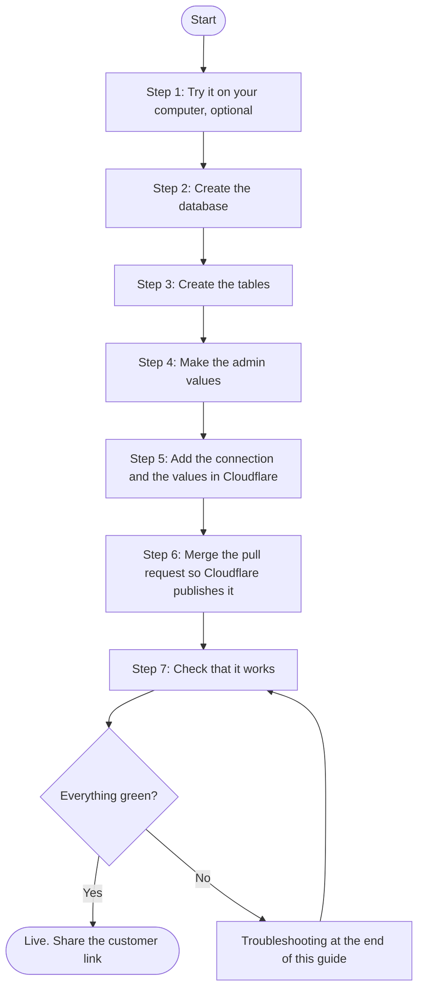

# Putting the dashboards live (deployment guide)

This guide is for whoever looks after the Jels Kitchenwares Cloudflare account. You do not need to write code. Allow 30 to 45 minutes.

**What "deploying" means here.** The storefront is already live at https://jels-kitchenwares.pages.dev. The customer pages (`/account/`), the admin pages (`/admin/`) and the store service behind them (`/api/`) are in this repository but only start working once three things exist in Cloudflare:

1. a **database** (Cloudflare D1) that remembers accounts, orders and products,
2. a **connection** from the website to that database, named `DB`,
3. **four private admin values** (your email, a scrambled password and an authenticator key).

Until all three are in place, `/account/` and `/admin/` show a friendly "not set up yet" message and nothing breaks. The storefront is not touched by any of this.

> Nothing in this repository creates or changes anything in Cloudflare by itself. Every step below is done by a person, on purpose.

## What you need before you start

| You need | Why |
| --- | --- |
| A Cloudflare login that can use the account **Jelvan - Business - Operava** | The `jels-kitchenwares` Pages project lives there |
| Permission to merge pull requests in the GitHub repository `DevJel/jelsketchenwares` | Merging publishes the change |
| A computer with **Node.js 20 or newer** | To run the one-minute script that makes the admin values |
| An authenticator app on your phone (Google Authenticator, Microsoft Authenticator, 1Password or Authy) | The second lock for the admin sign-in |
| A long admin password (at least 14 characters; a few unrelated words work well) | The first lock for the admin sign-in |

## The steps at a glance



---

## Step 1. Try it on your computer first (optional, recommended)

This shows you exactly what you are about to publish, using made-up demo accounts. Nothing is saved and nothing reaches Cloudflare.

1. Open a terminal in the repository folder.
2. Run `node --no-warnings scripts/dev-server.mjs` (needs Node 22.5 or newer).
3. Open the addresses it prints. The demo customer is `aisha@demo.local`; the admin needs the 6-digit code the script prints, which changes every 30 seconds.
4. Press `Ctrl+C` to stop.

**You should see:** the glass-style customer and admin pages with sample orders.

## Step 2. Create the database

1. In the Cloudflare dashboard, choose the account **Jelvan - Business - Operava**.
2. Go to **Workers & Pages**, then **D1 SQL database** (it may be listed under *Storage & databases*).
3. Choose **Create database**.
4. Name it `jels-kitchenwares-db` and choose **Create**. You can leave the location setting alone.

**You should see:** the new, empty database in the list.

## Step 3. Create the tables

The file `migrations/0001_init.sql` in this repository is the plan for the database: customers, sessions, products, orders and the activity log. It also adds the six products that are on the storefront today. It is safe to run twice, because every statement is written to skip what already exists.

1. Open the database you just created and choose the **Console** tab.
2. Open `migrations/0001_init.sql` on GitHub, choose **Raw**, select everything and copy it.
3. Paste it into the console and choose **Execute**.

**You should see:** a success message. The database now lists the tables `customers`, `sessions`, `auth_attempts`, `used_totp`, `products`, `orders` and `audit_log`.

*If you prefer a terminal:* once Wrangler (Cloudflare's command line tool) is signed in, `npx wrangler d1 execute jels-kitchenwares-db --remote --file=migrations/0001_init.sql` does the same. Wrangler may ask for the database to be listed in a configuration file first; the Console route avoids that.

## Step 4. Make the four private admin values

On your own computer, in the repository folder, run:

```bash
node scripts/admin-setup.mjs
```

It asks for:

- the admin **email** you will sign in with,
- an admin **password** (typed without showing on screen, entered twice).

It then prints:

- **Four values** to paste into Cloudflare: `ADMIN_EMAIL`, `ADMIN_PASSWORD_SALT`, `ADMIN_PASSWORD_HASH`, `ADMIN_TOTP_SECRET`.
- A **setup key** for your authenticator app.

Add the setup key to your authenticator app now: choose *Enter a setup key* (time-based) and type the key. The app will start showing 6-digit codes.

> **Keep these private.** The salt and hash cannot be turned back into your password, but the authenticator key is as sensitive as a password. Do not paste any of these into chat, email, a document or the repository. Clear the terminal when you are done. The script writes nothing to disk and sends nothing anywhere.

**You should see:** a 6-digit code changing every 30 seconds in your authenticator app.

## Step 5. Add the connection and the values in Cloudflare

Open **Workers & Pages**, choose the Pages project **jels-kitchenwares**, then **Settings**.

**5a. Connect the database**

1. Go to **Bindings**, choose **Add**, then **D1 database**.
2. **Variable name:** type exactly `DB` (capital letters).
3. **D1 database:** choose `jels-kitchenwares-db`.
4. Save. Do this for **Production**.

**5b. Add the four admin values**

1. Go to **Variables and Secrets** and choose **Add**.
2. Add each of the four names from Step 4 with its value. Choose **Encrypt** (type *Secret*) every time, so the value is hidden afterwards.
3. Save. Do this for **Production**.

| Name | What it is |
| --- | --- |
| `ADMIN_EMAIL` | The admin email you typed in Step 4 |
| `ADMIN_PASSWORD_SALT` | Printed by the script |
| `ADMIN_PASSWORD_HASH` | Printed by the script |
| `ADMIN_TOTP_SECRET` | Printed by the script (the authenticator key) |

Cloudflare reads these when a new version is published, so they need to be in place before the publish in Step 6, or the site needs to be published again afterwards.

**You should see:** `DB` under Bindings and four hidden entries under Variables and Secrets.

## Step 6. Publish (merge the pull request)

1. On GitHub, open the pull request for the dashboards and read through what changes.
2. Choose **Merge**. Cloudflare Pages is connected to the `main` branch, so it publishes automatically. There is no build step.
3. In Cloudflare, open the project's **Deployments** tab and wait for the newest **Production** deployment to say *Success* (usually under two minutes).

If you added the connection or the values *after* the deployment finished, open the Deployments tab and retry or redeploy the latest production deployment, so the new settings are picked up.

> Preview deployments are turned off for this project, so the dashboards can only be tried on the live site after the merge. That is why Step 1 is worth doing.

## Step 7. Check that it works

Work down this list. Each row says what you should see.

| # | Do this | You should see |
| --- | --- | --- |
| 1 | Open `https://jels-kitchenwares.pages.dev/api/health` | `{"ok":true,"database":true,"adminSignIn":true}` |
| 2 | Open `/admin/` and sign in with your email, password and the current 6-digit code | The **Overview** page with zeros and the six starter products |
| 3 | In **Products**, check the six products and prices | The same list as the storefront |
| 4 | In a private browser window, open `/account/` and create a test account | You land on *My orders*, which is empty |
| 5 | Choose **Request an order**, pick a product and send it | *Request sent*, then the request in *My orders* as *Waiting for the store* |
| 6 | Back in the admin, open **Orders** | The test request is listed. Open it and choose *Mark as Confirmed* |
| 7 | Back in the customer window | The status now says *Confirmed* |
| 8 | In the admin **Customers** tab, switch the test account off, then on again | The change appears in **Activity** |
| 9 | On a phone, open both pages | One **Menu** button at the top, and no sideways scrolling |
| 10 | Sign out of both | You are returned to the sign-in pages |

When you are done testing, you can switch the test account off from the **Customers** tab. Orders and accounts are not deleted from the dashboards, so a test order stays in the list; set it to *Cancelled* (as the customer, or from the admin) so it does not look like real work.

---

## Troubleshooting

Start with `/api/health`. It only ever shows three yes/no answers and never shows any secret.

| What you see | What it means | What to do |
| --- | --- | --- |
| The pages say **"not set up yet"** and health shows `"database": false` | The website cannot see the database | Check Step 5a: the variable name must be exactly `DB`, it must be set for **Production**, and the project must be published again after adding it |
| Health shows `"adminSignIn": false` | One of the four admin values is missing or misspelled | Check Step 5b: all four names, spelled exactly, each saved for **Production**, then publish again |
| Health shows both `true` but pages still say "not set up" | The browser kept an older copy | Refresh the page, or open it in a private window |
| `/api/health` itself shows an error page | The service did not publish | Open **Deployments** and read the latest production deployment's log. Check that the `functions` folder is in the repository's root |
| Admin sign-in says **"Those sign-in details are incorrect"** | Wrong email, password or code. The message is the same on purpose, so nobody can tell which part was wrong | Wait for a fresh 6-digit code and try once more. The code works once, so do not reuse one. Make sure your phone's clock is set to automatic |
| **"Too many attempts"** | Five wrong tries pause sign-in for about 15 minutes | Wait, then try again with care. The admin **Activity** tab lists failed sign-ins if you suspect someone else is guessing |
| You forgot the **admin password** | Passwords cannot be recovered, only replaced | Run `node scripts/admin-setup.mjs` again, replace the three changing values (`ADMIN_PASSWORD_SALT`, `ADMIN_PASSWORD_HASH`, `ADMIN_TOTP_SECRET`) and the email if it changed, add the new key to your authenticator app, and publish again |
| You lost your **phone** or authenticator app | The old key is the only way to make codes | Same as above: make a new set of values and a new key |
| A **customer** is locked out | They forgot their password | In the admin, open **Customers**, choose the person, then *Reset password*. Give them the one-time password shown. They must choose their own on first sign-in |
| **Sign-in works but pages look unstyled or blank** | A file was not published, or a browser extension is blocking scripts | Check the deployment log, then try a private window |

## Rolling back

If something goes wrong after publishing, you have two safe options:

- **In Cloudflare:** open the project's **Deployments** tab, find the last deployment that worked and use its roll back option. The storefront returns to that version straight away.
- **In GitHub:** open the merged pull request and choose **Revert**. Merge the revert pull request and Cloudflare publishes the previous state again.

Rolling back does not remove the database or its data, so accounts and orders stay safe.

## Keeping it healthy

- **Changing products and prices** is done in the admin **Products** tab. The storefront page still shows its own built-in list, which does not change when you edit products in the admin.
- **Changes to the database plan.** If a future update adds a new file to `migrations/`, run that file in the D1 **Console** (as in Step 3) *before* publishing the code that needs it.
- **Backups.** D1 offers a built-in restore feature called Time Travel. Check how far back it reaches on your Cloudflare plan, and write down how to use it before you need it.
- **Sign-in hygiene.** The store owner is signed out automatically after 8 hours and customers after 7 days. Change the admin password if anyone who knew it leaves.
- **Activity log.** Every sign-in and change the owner makes is recorded in the admin **Activity** tab. Look at it now and then.

## Quick checklist to print

- [ ] Tried it locally (optional)
- [ ] D1 database `jels-kitchenwares-db` created in the Operava account
- [ ] `migrations/0001_init.sql` executed in the Console
- [ ] `node scripts/admin-setup.mjs` run, values and authenticator key stored safely
- [ ] Binding `DB` added (Production)
- [ ] `ADMIN_EMAIL`, `ADMIN_PASSWORD_SALT`, `ADMIN_PASSWORD_HASH`, `ADMIN_TOTP_SECRET` added as secrets (Production)
- [ ] Pull request merged and the production deployment says *Success*
- [ ] `/api/health` shows `ok`, `database` and `adminSignIn` all `true`
- [ ] Test customer, test order and test admin sign-in done
- [ ] Phone check done
