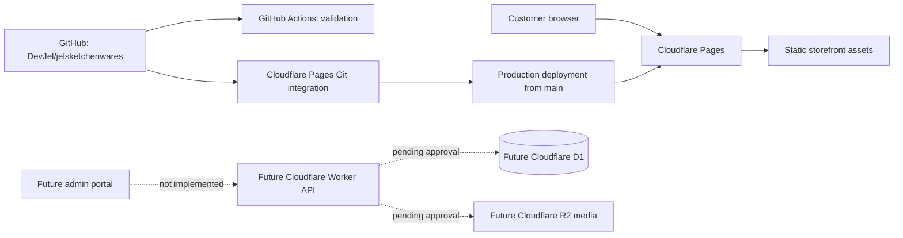

# Store platform architecture and implementation plan

**Status: revised platform decision — static production storefront hosted on Cloudflare Pages.** The Cloudflare Pages project has been created and connected to the GitHub repository. This does not mean the full e-commerce platform is complete or production commerce-ready.

## Current implementation

- Storefront: `index.html`, a self-contained bundled React export with CSS, application JavaScript and media.
- Products/media: embedded in the export.
- Cart: local demonstration only; no real order creation or checkout.
- Hosting: Cloudflare Pages project `jels-kitchenwares`.
- Production URL: https://jels-kitchenwares.pages.dev
- Source control: GitHub repository `DevJel/jelsketchenwares`, production branch `main`.
- Build: no build command; publish repository root (`.`).
- Preview deployments: disabled.
- The original editable React source and dependency lockfile are not present in the repository.
- No backend, database, buyer/admin authentication, persistent inventory, order store, payment integration, shipping integration or media-management interface is implemented.

**Aiven has been removed from the project architecture.** There is no Aiven database integration, connection string, service binding or dependency intended for this application. No replacement database has been provisioned. If persistent data becomes necessary, evaluate Cloudflare D1 first, with a migration and restore plan approved before production use.

## Hosting and deployment architecture

Cloudflare Pages is the production static host. GitHub remains the source repository and CI system, not the website host.

### Cloudflare Pages configuration

| Setting | Value |
| --- | --- |
| Account | Jelvan - Business - Operava |
| Project | `jels-kitchenwares` |
| Project URL | https://jels-kitchenwares.pages.dev |
| Git repository | `DevJel/jelsketchenwares` |
| Production branch | `main` |
| Build command | Empty (static site) |
| Output directory | `.` |
| Preview deployments | Disabled |

A successful deployment must be verified from the Pages deployment record before claiming the site is live. The Pages project creation and repository connection are complete; deployment status is tracked separately.

## E-commerce capabilities still requiring implementation

- **Buyer:** managed email OTP sign-in and access to only the buyer's own order history/statuses.
- **Admin:** separate privileged sign-in with enforced MFA, role checks and audit events.
- **Catalog:** server-backed product details, pricing, availability and inventory.
- **Media:** secure admin uploads and controlled publication of product images/videos.
- **Orders:** validated order creation, status transitions, buyer ownership checks and notifications.
- **Checkout/payment/shipping:** separate provider and workflow decisions; none is implemented.
- **Operations:** monitoring, backups, recovery, retention and incident procedures.

Do not simulate real orders or present the local demo cart as checkout.

## Security and data boundaries

1. Treat all browser input as untrusted. Enforce authorization on the server for every privileged operation.
2. Bind each buyer to a stable authenticated subject. Check order ownership server-side; do not trust client-supplied email or order IDs.
3. Require verified privileged identity and MFA for administrators. Never grant admin access based only on a client-side role field.
4. If D1 is adopted, use scoped Worker bindings, parameterized queries, migrations, separate test/production databases and tested backup/restore procedures.
5. OTP delivery must use a selected managed identity/email provider with expiry, single use, throttling, generic responses, secure sessions and recovery procedures.
6. If R2 is adopted, authorize uploads server-side, enforce type/size limits, generate object keys server-side and publish only approved media.
7. Minimize personal data and retention. Never log OTPs, credentials, tokens or payment-card data. Use an approved payment processor; do not store card data in the application database.
8. Keep secrets in Cloudflare secrets/environment configuration, never in `index.html`, Git history or public workflow output.

## Implementation work breakdown

1. **Maintainable UI source:** obtain the original React project and lockfile if available. Otherwise propose a reviewed migration from the bundled export, with screenshot and interaction parity tests before replacing it.
2. **Cloudflare backend (future):** design Worker API routes, D1 schema/migrations and R2 access only after the required business workflows and data model are approved.
3. **Buyer access:** integrate the selected managed email OTP provider; test invalid, expired, reused and throttled codes, sign-out and cross-buyer access denial.
4. **Admin portal:** implement MFA-backed privileged access, product create/edit/archive, media management and authorized order-status updates.
5. **Storefront integration:** preserve current visual design and cart behavior while connecting validated catalog data. Test mobile/desktop layouts, filters, sorting, quick view, errors and reduced motion.
6. **Commerce:** design order placement, payment and shipping only after provider and business rules are selected. No live checkout should be claimed before end-to-end verification.
7. **Release:** run browser, API, integration and security tests; secret/dependency scans; restore exercise; staged deployment; monitoring and rollback review.

## Decisions and stop conditions

| Decision | Current status |
| --- | --- |
| Static hosting | Cloudflare Pages selected and project created |
| Production branch | `main` |
| Database | None provisioned; consider Cloudflare D1 only after approval |
| Object storage | None provisioned; consider Cloudflare R2 after media requirements are defined |
| Buyer identity/OTP provider | Not selected |
| Admin identity/MFA | Not selected |
| Order creation/payment/shipping | Not selected; no checkout |
| Editable React source | Not supplied |

Stop work affecting authentication, customer data, production resources or paid services when provider choice, access boundaries or approval is unclear. Keep preview/test and production data isolated.

## Acceptance evidence

- The production Pages deployment completes successfully and the deployed site passes browser smoke tests.
- Existing storefront UI and interactions match the baseline on mobile and desktop.
- Buyers cannot read another buyer's orders, including by guessing identifiers.
- Non-admins cannot access privileged catalog, order or upload operations; admin access enforces MFA.
- No secret appears in client bundles, logs, source or workflow output.
- API, integration and security tests run against isolated test data.
- Checkout is not claimed until an approved real order/payment flow is tested end to end.
- A reviewer confirms monitoring, backup/restore, rollback and user-facing documentation before production commerce release.

Applicable guidance considered: `CODE-001`, `CODE-004`, `CODE-009`, `IAM-001`, `IAM-002`, `IAM-004`, `DATA-002`, `DATA-008`, `SDLC-003`, `SDLC-009`, and Cloudflare platform guidance where applicable.
