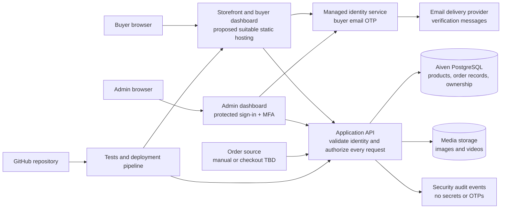

# Store platform architecture and implementation plan

**Status: research draft — not implemented or approved.** The design below is a proposal and does not establish production readiness or compliance. Decisions, accounts, permissions, services, and costs must be confirmed before provisioning or deployment.

## Current state

At the time of this draft, `index.html` is a self-contained, bundled React export. Products and media are embedded in that file; the cart is a local demo that explicitly says there is no checkout. The repository has no editable React source project, backend, database integration, order store, or authentication implementation. Existing storefront appearance and behavior are to be preserved while replacing hard-coded data with approved live integrations. Aiven PostgreSQL 18 was shown provisioning by the project owner; its operational status, connection details, isolation, and access have not been verified.

GitHub Pages serves the current static site but is not permitted for running an e-commerce site or facilitating commercial transactions. See [GitHub Pages limits](https://docs.github.com/en/pages/getting-started-with-github-pages/github-pages-limits). Keep the GitHub repository for source and CI; choose suitable hosting for the commercial application.

## Outcomes and scope

- **Buyer:** sign in using an email one-time code and view only their own orders and statuses. Handle loading, empty, expired-code, rate-limited, and unavailable-service states.
- **Admin:** sign in separately with enforced multi-factor authentication; manage product details, availability, images and videos, and authorized order-status changes. Sensitive actions require server-side authorization and audit records.
- **Storefront:** preserve the current design, product browsing, cart and behavior. Replace static content only after an equivalent, validated data path exists. A working checkout, payment processing, shipping integration, and source of orders are separate decisions; none currently exists in the repository.
- **Operations:** document environments, configuration, security controls, tests, deployment, monitoring, recovery and ownership before release.

## Proposed architecture — subject to approval

Cloudflare hosting/API and R2 are options, not approved choices. An identity/email provider and order-creation method have not been selected. Aiven is the proposed PostgreSQL provider. Do not connect a browser directly to PostgreSQL or embed server credentials in site assets.

### Trust and data boundaries

1. The client is untrusted. Verify identity and role in the backend for every protected action. An admin-looking URL or hidden button is not access control.
2. Bind each buyer to a stable authenticated subject and authorize each order by ownership on the server. Do not use a client-supplied email or order ID alone as proof of ownership. Deny access by default.
3. Admin access requires a verified privileged identity, MFA and least privilege. Never grant admin rights based solely on a browser-supplied role or email field.
4. Use a dedicated least-privilege database role, encrypted connections with certificate verification, parameterized queries, separate test/production resources, secret management and backup/restore testing. The Aiven connection has not been configured or tested.
5. OTP verification belongs to a reputable identity service, not custom code in the static site. Apply short expiry, request/verification throttles, single-use codes, generic responses to avoid account enumeration, secure sessions and recovery procedures. Actual provider settings need review.
6. Authorize uploads on the server, restrict type and size, use server-generated object keys, and validate content. Use private staging, malware review/scanning as appropriate, and publish only approved product media through a controlled delivery path. Do not expose arbitrary user uploads or credentials.
7. Minimize personal data in storage and logs, define retention and deletion, and audit admin actions without logging OTPs or secrets. Payment card data must be handled by an approved payment provider, never by the storefront or this database.

## Implementation work breakdown

1. **Human — architecture decisions:** choose hosting/API account, identity/email provider, media storage, order source, deployment environments, admin identities and approvers. Confirm billing, domain, privacy, retention and backups. Do not provision resources without approval.
2. **AI — recover maintainable UI source:** obtain the original React project and lockfile if available. Otherwise propose and review a migration from the bundle with screenshot and interaction parity tests before replacing it. Do not claim the minified export is maintainable source.
3. **AI — database and API:** after contracts are approved, design reversible migrations and least-privilege database access; implement authenticated product and order APIs, ownership checks, validation, audit events and error handling. Human review and isolated test database required.
4. **AI — buyer access:** integrate the chosen managed email OTP provider and a buyer-only order dashboard. Test invalid, expired, reused and throttled OTPs; sign-out; and cross-buyer access denial.
5. **AI — admin dashboard:** implement MFA-backed privileged access, product create/edit/archive, media management, and authorized order-status updates. Test unauthorized requests, uploads, limits, failure handling and audit records. Exact permissions and statuses require owner approval.
6. **AI — storefront integration:** connect catalog and media without changing the established visual design or cart behavior; test narrow and desktop layouts, filters, sorting, quick view, cart, errors and reduced motion. Order placement and payment require their own approved design.
7. **AI and human — release:** run automated and manual acceptance tests, security review, dependency and secret scans, a verified restore exercise, staged deployment, monitoring and rollback review. An authorized owner makes the production go/no-go decision.

## Open decisions and stop conditions

| Decision | Needed before | Status |
| --- | --- | --- |
| Hosting/API account and environment | Platform-specific deployment and secrets | Not selected |
| OTP identity and email delivery providers | Real buyer sign-in | Not selected |
| Admin identity and MFA method | Real privileged access | Not selected |
| Object storage and video limits | Real media uploads | Not selected |
| Order creation and payment source | Real orders and status dashboard | Not selected |
| Dedicated Aiven database/role and access | Migrations and database integration | Not verified |
| Original editable React project | Reliable component-level refactoring | Not supplied |

Stop work affecting authentication, database access, production resources or paid services when authorization, boundaries or the chosen provider are unclear. No credentials, tokens, OTPs, customer data, live infrastructure or production changes are included in this draft.

## Acceptance evidence

- Buyers cannot read another buyer's orders, including by guessing identifiers; unverified and expired sessions are rejected.
- Non-admins cannot access privileged product, order or upload operations; privileged access enforces MFA.
- Product/media operations validate input and failures; no secret appears in client bundles, logs, source or workflow output.
- Existing storefront UI and interactions are compared against the current baseline on mobile and desktop.
- API, integration and security tests run against isolated test data; checkout is not claimed until a real order and payment path is approved and tested.
- A reviewer confirms deployment, backup/restore, monitoring, rollback and user-facing documentation before production release.

Applicable guidance considered: `CODE-001`, `CODE-004`, `CODE-009`, `IAM-001`, `IAM-002`, `IAM-004`, `DATA-002`, `DATA-008`, `SDLC-003`, `SDLC-009`, and, if Cloudflare is approved, `CF-001`, `CF-007`, `CF-012`.
